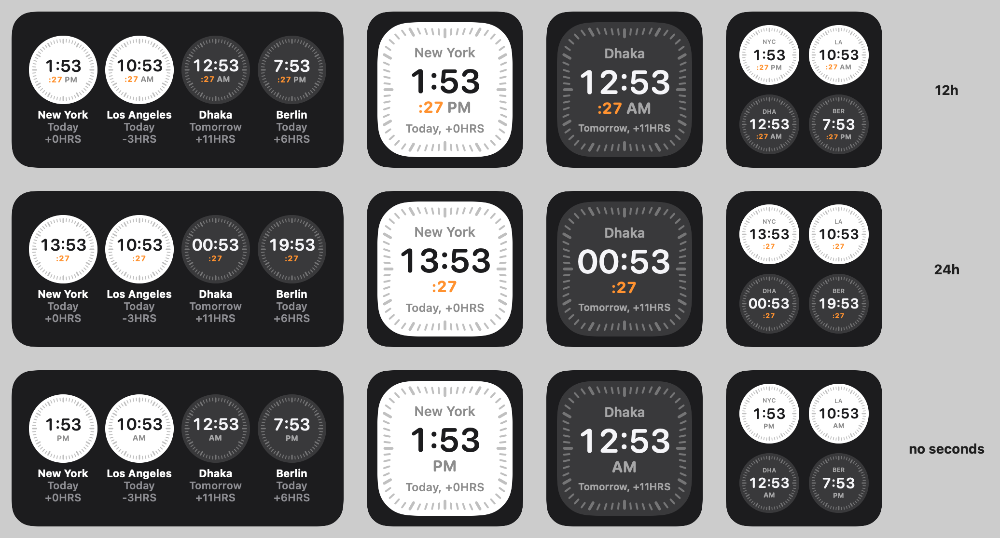

# Digital World-Clock Widgets for macOS

Compare local times across up to 12 cities on your Mac desktop or in Notification Center. Each digital clock shows the local time, whether it’s day or night there, and how far ahead or behind the city is relative to your Mac.



Apple’s Clock app and its analog World Clock and City widgets inspired this project. My widgets build on that design with digital faces that show each city’s local time in either 12-hour or 24-hour format.

## Install

Requires an Apple silicon Mac running macOS 26 or later. Tested on macOS 27.2.

1. [Download Digital-World-Clock-Widgets.zip](../../releases/latest/download/Digital-World-Clock-Widgets.zip).
2. Unzip the download, move **Digital World-Clock Widgets.app** to **Applications**, and double-click it.
3. **If macOS says it can’t verify the developer** and you trust the copy you downloaded from this release, click **Done**. Open ** → System Settings → Privacy & Security** and scroll to **Security**. Find the message naming **Digital World-Clock Widgets**, click **Open Anyway**, and confirm **Open**. Enter your password or use Touch ID if prompted. [Apple’s guide to opening downloaded apps](https://support.apple.com/en-us/102445)
4. After the app opens once, right-click the desktop, choose **Edit Widgets**, and search for **Digital World-Clock Widgets**. Choose **City Digital** for one large clock or **World Clock Digital** for several cities.

Open the app to set your default cities and their order. Right-click an individual widget and choose **Edit Widget** to change its cities, time format, or seconds display.

## How it works

- **Live digits in WidgetKit.** SwiftUI’s live date text keeps the seconds ticking. The widget timeline handles less frequent changes, such as a city reaching midnight or its UTC offset changing. The planner allocates fewer entries as the number of clocks grows to keep large widgets within the timeline archive limit. [Timeline planner](Shared/Core/TimelinePlan.swift)
- **Daylight at the city’s coordinates.** A light face means the sun is up in that city. The app calculates sunrise and sunset locally, including the periods when the sun stays above or below the horizon in polar regions. [Solar calculations](Shared/Core/SunCalculator.swift)
- **One VoiceOver element per city.** Each clock groups the city name, relative day, time difference, and local time into one accessible element. A VoiceOver user can move through a row of clocks one city at a time. [Widget layouts](Shared/UI/WidgetLayouts.swift)

## Build from source (optional)

For development, install Apple’s Command Line Tools and Python 3. From the repository root, generate the city catalog and build the app.

```sh
python3 Shared/scripts/gen_cities.py
macOS/scripts/build.sh
```

To try your local build, run `macOS/scripts/install.sh`.

## Credits and license

Copyright © 2026 Sayed Farazi. The original code and documentation are available under the [MIT License](LICENSE).

Apple and macOS are trademarks of Apple Inc. This is an independent project. Apple retains its rights in its own materials and trademarks.
